# NativeForge

An Android IDE for C and C++ that compiles **on the device**: write code with
clangd completion and live errors, build it with clang and CMake, Make or Ninja
(or the built-in build), run console programs in a real terminal or graphical
programs full screen (OpenGL ES, Vulkan, raylib, SFML, SDL2, SDL3, Dear ImGui, LVGL), and export any program
as a standalone APK with its own name, package id and version. It works with a
touch screen or with a physical keyboard and mouse, using VS Code shortcuts.

> Status: **0.11.1**. See [docs/ROADMAP.md](docs/ROADMAP.md) for what works today
> and what comes next, and [docs/FDROID.md](docs/FDROID.md) for the F-Droid status.

<p align="center">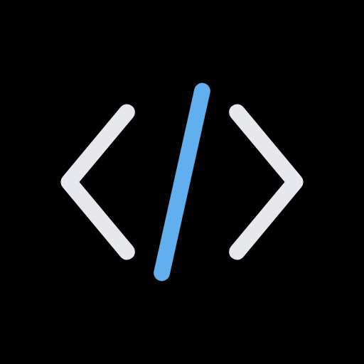</p>

## Screenshots

### Editor and projects

<p align="center">
  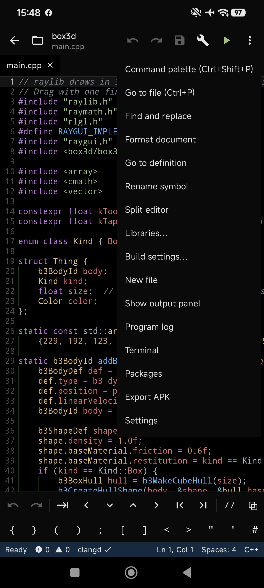
  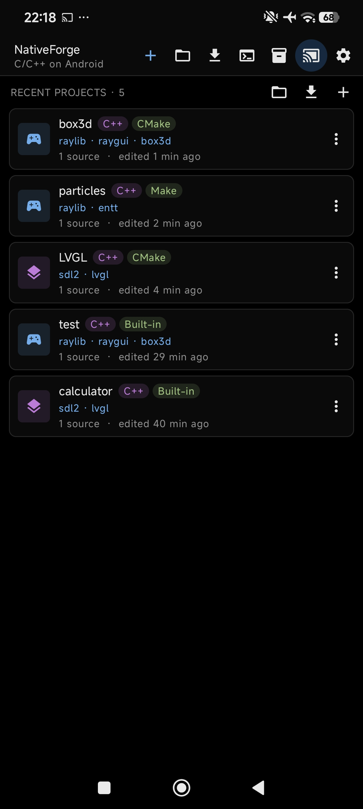
  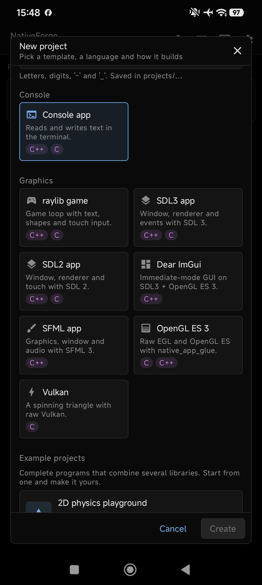
  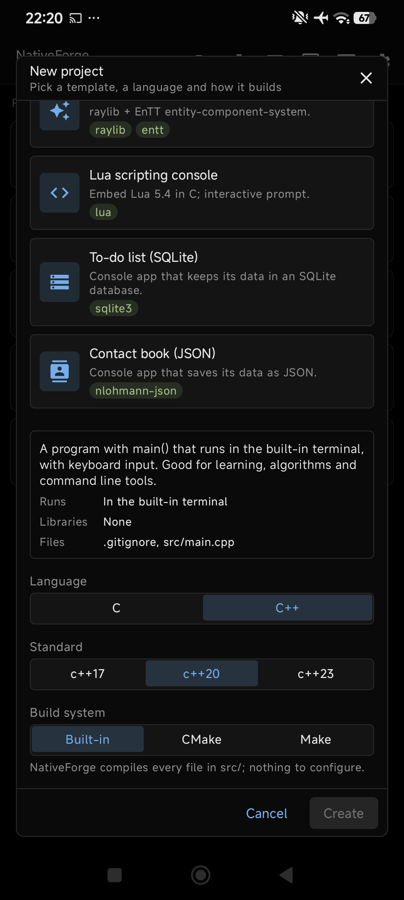
</p>

### Libraries and assets

<p align="center">
  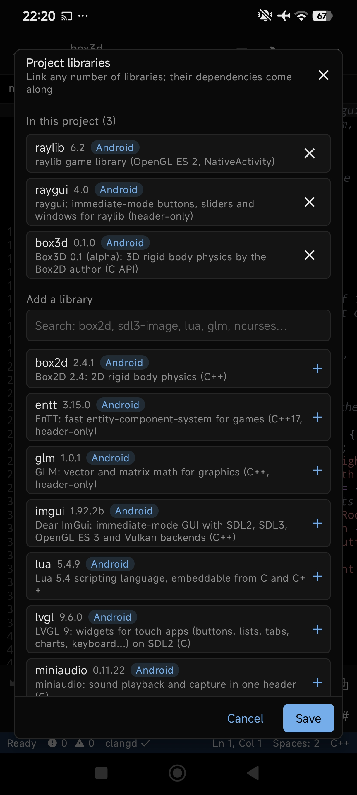
  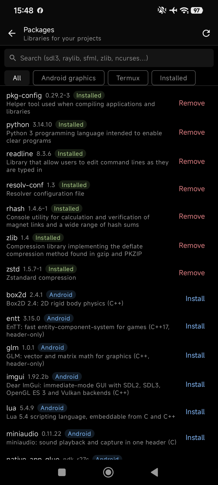
  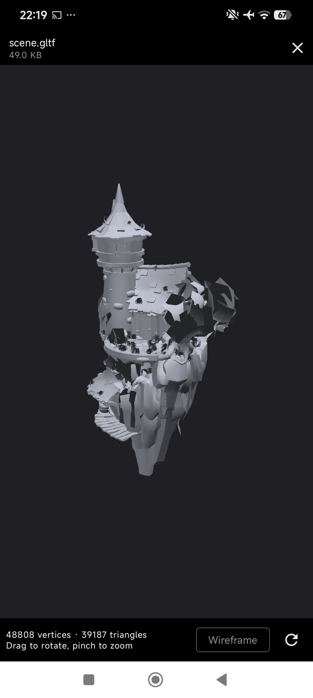
</p>

### Export

<p align="center">
  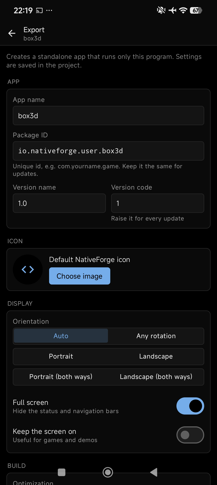
  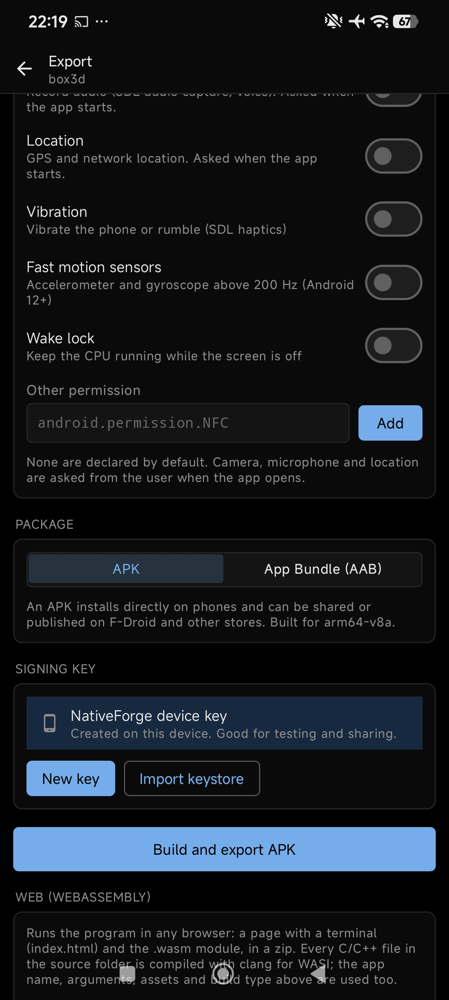
</p>

### Remote access from a computer's browser

The same IDE on a computer, connected to the phone over Wi-Fi: editor, explorer
and build output, with the graphical program streamed from the phone.

<p align="center">
  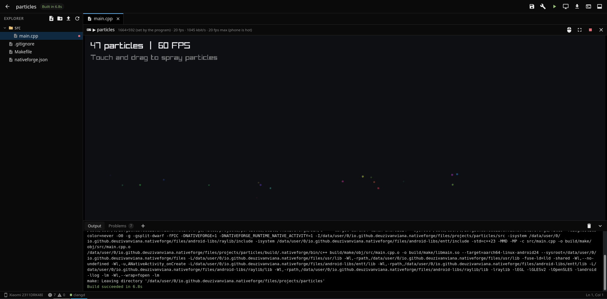
</p>
<p align="center">
  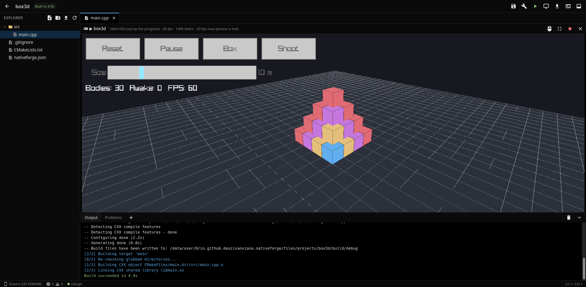
</p>

### Example: voxel sandbox (raylib + Box3D)

An endless block world made from noise as you walk: seas, beaches, forests and snowy peaks.
Walk, run, sneak, swim and fly with on-screen controls; break and place blocks, punch things
with your bare hand, and throw balls, crates, barrels, dominoes, tyres and bombs (which blow
craters) from a creative inventory. Box3D makes them roll, float and topple. One of the
example projects in New project, split into a few files.

<p align="center">
  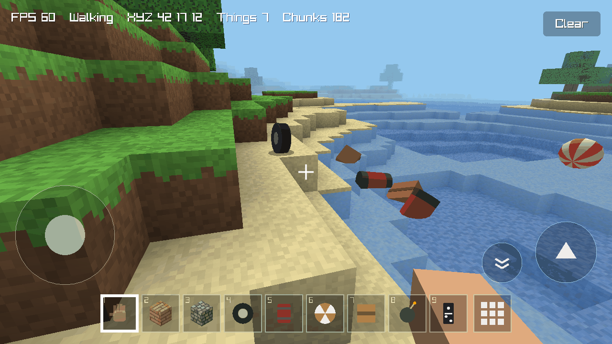
</p>

## Features

| Area | What it does | Where |
| --- | --- | --- |
| Editor | Sora Editor with TextMate grammars for C, C++ and CMake, tabs, split editor, 33 editor themes, undo/redo, find and replace, shortcut and symbol bars | `feature/editor` |
| Code intelligence | clangd: completion, live errors and warnings, go to definition, rename, symbol information; optional clang-tidy | `core/lsp`, `core/codeintel`, `app/.../intel` |
| Formatter | clang-format with a project `.clang-format` or a chosen style (LLVM, Google, Chromium, Mozilla, WebKit, Microsoft, GNU), optional format on save | `core/codeintel` |
| Keyboard and mouse | VS Code shortcuts (command palette, quick open, build, go to line, move lines, comment...), Ctrl+wheel zoom | `app/.../workspace/commands` |
| Asset viewer | Images (PNG, JPEG, WebP, GIF, BMP, TGA), sounds, 3D models (OBJ, STL, PLY, glTF/GLB) and fonts | `core/assets`, `feature/assets` |
| Projects | Projects in NativeForge's storage, or in any folder of the phone or SD card, opened and built where they are (Open folder; the files stay visible to other apps); folders from cloud drives can be imported as a copy | `core/project`, `app/.../storage` |
| Explorer | Collapsible tree with file icons, new file/folder, rename, delete; Changes tab with git status, diffs, commit, pull and push | `app/.../workspace` |
| Git | Clone over HTTPS (no submodules, hooks or symlinks), status, diff, commit, discard, pull/push with an in-memory token | `core/vcs` (JGit) |
| Settings | App theme (11 palettes), editor theme, font size, tab width, wrap, line numbers, terminal font, auto save, explorer swipe, git author | `app/.../settings` |
| Toolchain | clang/lld/cmake/ninja/make from the Termux repository, installed into the app | `core/toolchain`, `core/packages` |
| Builds | Four independent build systems: built-in (incremental, single folder), CMake (Ninja or Unix Makefiles generator), Make and Ninja. Imported projects are detected automatically; the program file is found or set in Build settings | `core/build` |
| Packages | 25 bundled Android libraries (SDL3 and SDL2 + image/ttf/mixer, Dear ImGui, LVGL, raylib + raygui, SFML, Box2D, Box3D, Lua, SQLite, GLM, EnTT, JSON, stb, miniaudio, GLES, Vulkan), your own HTTPS package repositories (Settings), plus Termux libraries for console programs; any number per project | `core/packages`, `packages/` |
| Terminal | Termux terminal emulator with a PTY, extra keys bar | `feature/terminal` |
| Graphics | NativeActivity host + native shim (raylib, SFML, OpenGL ES) and SDLActivity hosts for SDL3 and SDL2 | `feature/runner` |
| Templates | Console, raylib, SDL3, SDL2, Dear ImGui, LVGL, SFML, OpenGL ES and Vulkan, in C or C++ (C libraries are used from C++ through their `extern "C"` headers), with the built-in build, CMake or a Makefile; example projects sized from the screen: 2D physics (raylib + Box2D), 3D physics (raylib + Box3D), voxel sandbox (raylib + Box3D), LVGL widgets demo, to-do list and calculator, OpenGL ES cube (SDL3 + GLM), touch synthesizer (SDL3 audio), snake game (SDL3), finger painting (raylib + raygui), particles (raylib + EnTT), Lua console, SQLite to-do list and JSON address book | `core/project` |
| Remote access | Use the IDE from a computer's browser on the same Wi-Fi or VPN, with the app's look: projects, explorer, editor with clangd, build and run, problems, terminals, and graphical programs streamed as video with keyboard, mouse and touch sent back. HTTPS with a certificate made on the phone, one-time pairing codes, local networks only; keeps running with the screen off and stops when idle | `core/remote`, `app/.../remote` |
| Export | APK or Android App Bundle (AAB) for Google Play from a prebuilt runtime template (binary or proto manifest patched on the device), libraries and the project's `assets/`, custom icon, orientation, full screen, keep screen on, release or debug; signed with apksig using the device key or your own keystore (create, or import JKS/PKCS#12/BKS, back up). Console programs also export to the web: clang builds them for WebAssembly (WASI) and they run in any browser from one self-contained `index.html` with a terminal | `core/export`, `app/.../signing`, `runtime-template` |

## Building

Requirements: JDK 17+, Android SDK (API 35) and NDK `27.2.12479018`.

```bash
./gradlew test                # JVM unit tests for every core module
./gradlew :app:assembleDebug  # IDE APK (embeds the runtime template APK)
```

CI (GitHub Actions):

| Workflow | When | What |
| --- | --- | --- |
| `android.yml` | every push to `main` and every pull request | unit tests and the debug APK (workflow artifact) |
| `libs-from-source.yml` | pull requests that touch `packages/`, or by hand | rebuilds every bundled library from its pinned sources and compares with the committed index |
| `release.yml` | a `v*` tag | libraries from source, tests, release APK (signed when the `RELEASE_*` secrets are set), GitHub release with the changelog |

To publish a version: bump `versionCode`/`versionName` in `app/build.gradle.kts`,
add `fastlane/metadata/android/*/changelogs/<versionCode>.txt`, merge, and push
a tag such as `v0.7.2`.

The bundled libraries in `app/src/main/assets/packages/` are rebuilt with
`packages/build-android-libs.sh`; every source file it downloads is checked
against `packages/sources.sha256`.

Optional: `-Pnativeforge.packageIndexUrl=<url>` points the IDE at an index of
Android-targeted libraries (see [packages/README.md](packages/README.md)).

## Project layout

```
app/                 IDE application: screens, view models, dependency wiring
runtime-template/    Minimal app that hosts exported programs (patched on export)
core/common          Outcome/NfError, process runner, logging, dispatchers   (JVM)
core/project         Project model, nativeforge.json, templates, LaunchSpec  (JVM)
core/toolchain       ABI, on-device layout, clang toolchain                  (JVM)
core/build           Build systems, executor, diagnostics parser             (JVM)
core/packages        Package sources, resolver, installer                    (JVM)
core/export          Binary manifest patcher, APK assembler, signing         (JVM)
core/vcs             Git client (JGit): clone, status, diff, commit, pull    (JVM)
core/lsp             JSON-RPC and Language Server Protocol client             (JVM)
core/codeintel       clangd session, compile database, clang-format          (JVM)
core/assets          Asset kinds, model parsers (OBJ/STL/PLY/glTF), TGA      (JVM)
core/remote          Remote web IDE: HTTPS/WebSocket server and web UI        (JVM)
core/ui              Compose theme and shared components
feature/editor       Code editor (Sora + TextMate)
feature/terminal     Console activity (Termux terminal-view)
feature/runner       Graphical program hosts + native shim
feature/assets       Asset viewer (images, audio, OpenGL ES model preview)
build-logic/         Gradle convention plugins
```

Read [docs/ARCHITECTURE.md](docs/ARCHITECTURE.md) before adding a feature: it lists
the extension points (new build system, package source, runtime host, template).
[docs/SECURITY.md](docs/SECURITY.md) explains what the IDE protects against.

## Keyboard shortcuts

| Shortcut | Action |
| --- | --- |
| Ctrl+Shift+P, F1 | Command palette |
| Ctrl+P | Quick open a file |
| Ctrl+S | Save |
| Ctrl+Shift+B, F7 / F5 | Build / Run |
| Ctrl+F, Ctrl+H, F3 | Find, replace, find next |
| Ctrl+G | Go to line |
| Ctrl+Space | Suggestions |
| F12, F2, Ctrl+Shift+I | Go to definition, rename, symbol information |
| Shift+Alt+F | Format document |
| Ctrl+/ | Toggle comment |
| Alt+Up/Down, Shift+Alt+Down, Ctrl+Shift+K | Move line, duplicate line, delete line |
| Ctrl+Tab, Ctrl+PageDown/PageUp, Ctrl+W, Ctrl+N | Next/previous tab, close tab, new file |
| Ctrl+\\, Ctrl+2 | Split editor, focus the other editor |
| Ctrl+B, Ctrl+J, Ctrl+` | Explorer, output panel, terminal |
| Ctrl+=, Ctrl+-, Ctrl+wheel | Font size |
| Ctrl+, | Settings |

## Toolchain and privacy

The app does not include a compiler. When you tap Install on the home screen,
it explains what will be downloaded and asks first; then it downloads clang,
lld, CMake, Ninja and Make from the [Termux](https://termux.dev) package
repository into its own storage. Git clone, pull and push talk to the server
you give. Android's "Files and media" permission is asked only when you open
or create a project in a folder outside the app, and NativeForge only reads
the folders you open. There are no ads, analytics or trackers.

## Contributing

Issues and pull requests are welcome. Notes for AI coding assistants are in
[CLAUDE.md](CLAUDE.md) (also read through [AGENTS.md](AGENTS.md)). Keep code and comments in English, add a
JVM test for logic in `core/*`, and run `./gradlew test :app:assembleDebug`
before sending a change.

## License

NativeForge is free software: you can redistribute it and/or modify it under
the terms of the GNU General Public License as published by the Free Software
Foundation, either version 3 of the License, or (at your option) any later
version. See [LICENSE](LICENSE).

Third-party components keep their own licenses, listed in
[THIRD_PARTY_NOTICES.md](THIRD_PARTY_NOTICES.md). Programs you write and export
with NativeForge are yours; the runtime template and native shim that exported
APKs include are also offered under the zlib license (see
[LICENSE.runtime](LICENSE.runtime)), so exported programs can use any license.
